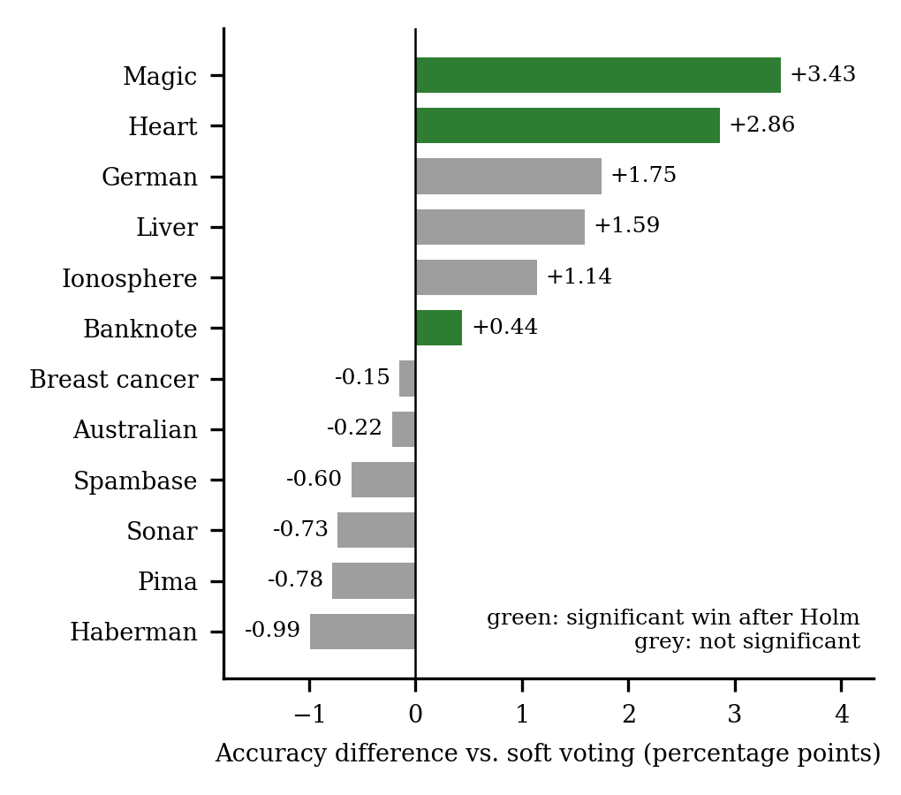

# DACS + Consensus/Debate Ensemble: current status and findings

**Read this first.** These are the findings after a data-leakage correction, the confirmatory test and the ablation.
They supersede any older numbers or framing elsewhere in this repository.

> **Erratum (Pima data leak).** Earlier versions of this repository and paper reported a significant Pima Diabetes win
> (86.66% vs 83.72% soft voting, McNemar p = 0.0003) and "4 of 12 significant wins". Those Pima numbers were wrong. The
> file `pima_diabetes.csv` we used had been imputed with *class-conditional* medians (Insulin 102.5 for negatives, 169.5
> for positives, covering 374 of 768 patients; the same pattern in Glucose, BloodPressure, SkinThickness and BMI), so the
> label could be read off the features. The raw file is now used, zero-coded missing values are treated as missing and
> imputed with training-fold medians inside each fold. Corrected Pima result: **75.39% vs 76.17%, p = 0.27, not a win.**
> The contaminated file is kept only for the record in `data/deprecated/`; previous result files are in
> `results/deprecated/`. Re-running the same file could never have exposed this, so re-runs and the fixed-beta control
> reproduced the inflated number.

1. **Main study (12 UCI datasets):** with the accuracy margin (0.05) in classifier selection, DACS+Debate has **3
   significant wins (Magic Gamma, Heart Disease, Banknote Authentication) and 0 significant losses** against soft voting
   after Holm correction (before the margin: 0 wins, 1 loss). Nominally ahead on 6 of 12; mean +0.65 pp, median +0.15 pp.
   Heart passes narrowly (Holm p = 0.041). *Caveat:* the margin was chosen after seeing the earlier rule fail on
   Banknote, a dataset in this evaluation, so this is not a clean held-out confirmation.
2. **Confirmatory test (7 unseen datasets, protocol written in `PREREGISTRATION.md` before any run; it was committed as `26dea9f` in the authors' earlier working repository, whose history is not included here, so this is a self-reported timestamp):**
   ahead of soft voting on 6, tied on 1, never behind; mean +1.53 pp; exact sign test p = 0.031; only phoneme is
   individually significant after Holm correction (+6.4 pp); mean gain excluding phoneme +0.71 pp. These 7 datasets were
   screened for label-leaking artefacts and none was found. (`PREREGISTRATION.md` is a frozen historical file and still
   quotes the old "4 of 12"; that figure is superseded by this erratum.)
3. **Ablation (exploratory):** removing the iterative revision rounds changes mean accuracy by about 0.01 pp on the 12
   main datasets (largest single-dataset difference 0.72 pp). **The "debate" step adds essentially nothing.** Later
   analyses (items 4, 9 and 10 below) show the gain over soft voting comes mainly from dropping one badly matched member
   of the voting baseline and from using a larger pool with accuracy weighting; the diversity step adds nothing beyond
   that. The method name overstates what the evidence supports.
4. **Where the gain over soft voting comes from (post hoc, 12 main datasets, identical folds, `run_baselines.py`):** every
   arm that picks or weights members of the same 13-classifier pool by cross-validated accuracy beats soft voting over
   four fixed classifiers. Mean accuracy: soft voting 83.06%, best single classifier 83.41%, all 13 weighted 84.07%,
   **top-4 by accuracy weighted 84.10%**, margin selection without revision 83.69%, proposed method 83.71%. Mean ranks:
   2.42 (top-4) vs 3.71 (proposed). The diversity step is 0.41 pp *behind* plain top-4 by accuracy (ahead on 5, behind on
   7). **Conclusion: the margin-and-diversity selection and the revision rounds add no measurable benefit; the gain
   comes from the larger pool and accuracy weighting.** These arms were added after the frozen protocol and were not
   rerun on the 7 confirmatory datasets.
5. **Novelty:** the principle "do not select on diversity alone" and greedy accuracy-and-diversity selection are
   established (Kuncheva and Whitaker 2003; Brown and Kuncheva 2010; Jan and Verma 2019; Ferreira et al.). This work
   claims only a measurement of one simple margin rule in a particular method under a leakage-checked protocol.
6. **Versus prior papers (different protocols, indicative only):** Pima 75.39% vs 79.04% reported by Kumari et al. 2021
   (3.65 pp below); Heart 84.17% vs 85.48% reported by Latha and Jeeva 2019 (1.31 pp below; their figure is not
   verified here). Earlier drafts quoted 79.08% for Kumari et al.; the published abstract says 79.04%, so confirm
   against the PDF.
7. **Extra metrics (Pima and Heart only, pooled out-of-fold):** precision, recall, F1, ROC AUC and confusion matrices
   are in `results/predictions/metrics.json`. Heart: F1 0.821 vs 0.791 for voting. Pima: F1 0.611 vs 0.633.
8. **Pre-specified test on new medical datasets (`PREREGISTRATION_HEALTHCARE.md`, SHA-256 in
   `PREREGISTRATION_HEALTHCARE.sha256`, frozen before any model was fitted):** four datasets not used elsewhere (WDBC,
   Hepatitis, Ljubljana breast cancer, prostate-cancer recurrence). The method was significantly better than soft voting
   on **1 of 4** (Ljubljana, +6.27 pp, Holm p = 0.0038) and equal or within +0.5 pp on the others. The rule fixed in advance
   required at least 2, so **"the method works better than soft voting on medical data" is NOT SUPPORTED**; the diversity
   step (S vs T) is also not supported. Low power (4 datasets); Hepatitis and Prostate sit near the majority-class rate.
   On Ljubljana the simpler pool-based arms also beat soft voting, so the gain is again largely a pool/weighting effect.
   The earlier five-dataset medical subset reported in the accompanying paper is post hoc and descriptive only.
9. **Why do the wins occur? (exploratory, `code/explain_gains.py`)** Only partly understood. On Ljubljana, naive Bayes
   alone scores 44.4% (one-hot categorical data) and drags soft voting below its best member; on Magic the pool contains
   stronger learners than the fixed four. Across 16 datasets the proposed method's gain is only weakly related to how far soft
   voting falls below its best member (Spearman rho +0.30, p = 0.26); the all-13 arm shows stronger relations (p = 0.04,
   0.01) that do not survive correction for six tests. Consistent with "weak members of the fixed voting set, not the
   selection rule, produce the gains", but not established.
10. **Controlled decomposition (exploratory, `code/ladder.py`):** changing one ingredient at a time between soft voting and the
   pool-based arms, on identical folds (16 datasets; recomputed soft voting matches the stored result exactly). Dropping the
   weakest of the four voting members, chosen on training-fold cross-validation only, adds +0.64 pp on average (ahead on
   12 of 16) and recovers about 71% of the proposed method's mean gain (+0.91 pp). Share recovered on the winning
   datasets: Magic 60%, Heart 76%, Banknote 83%, Ljubljana 53%. The weak member is naive Bayes on Magic, Banknote and Ljubljana
   and the depth-5 tree on Heart. The remainder comes from stronger pool learners and accuracy weighting (top-4 and all-13
   arms reach +1.25 and +1.23 pp, above the proposed method). Limit: on Sonar the "weakest" member (kNN) is actually the best
   on test folds and dropping it costs 2.9 pp, since small-sample CV can mis-rank members. Conclusion: the wins over soft
   voting are mostly a weak-link plus pool effect; the diversity step and the revision rounds add nothing beyond it.

## Demo app (illustration only)

```bash
pip install -r requirements.txt
cd app && python3 app.py        # then open http://127.0.0.1:5050
```

Offers all 16 datasets (the 12 main-study sets and the 4 pre-specified medical sets). It uses one 80/20 split for speed, so
on small datasets the numbers are noisy (for example Hepatitis has only 31 test rows) and are **not** evidence for or against
the method; the rigorous results are in `results/`. Trained models are cached in `app/model_cache/`; the cache key includes a
hash of the data content, so changing a data file never reuses an old model. Delete `app/model_cache/` any time.

## Reproduce

```bash
cd code
python3 run_with_predictions.py pima 240    # resumable; repeat until it prints ALL COMPLETE
python3 run_with_predictions.py heart 240
python3 analyze_predictions.py              # metrics + comparison with saved main-study values
python3 summarize_main.py                   # Holm-corrected summary_table.csv for all 12 datasets
for k in pima heart australian haberman liver magic spambase banknote breast_cancer german ionosphere sonar; do
  python3 run_baselines.py $k 250   # resumable; repeat until ALL COMPLETE (about 10 minutes in total)
done
python3 analyze_baselines.py                # checks arms A and V reproduce the main study, then summarises
for k in wdbc hepatitis ljubljana prostate; do python3 run_healthcare.py $k 250; done   # resumable; pre-specified medical test
python3 analyze_healthcare.py               # applies the frozen decision rule
python3 explain_gains.py                    # exploratory: correlation of gains with weakness of the voting baseline
python3 ladder.py                           # exploratory: controlled step-by-step decomposition of the gain
python3 dataset_characteristics.py          # results/dataset_characteristics.csv
python3 make_figures.py                     # regenerates the figures in results/figures (flowchart, results, ROC/PR, ranks)
python3 data_screen.py                      # label-leak screen for every loader
```

Confirmatory study: `cd code && python3 confirmatory.py` (resumable), then `python3 analyze_confirmatory.py` and
`python3 exploratory_no_debate.py`. Selection cross-validation is memoized (`debate_ensemble._cv_stats`).

A research paper accompanies this code and is not part of this repository.

---

# DACS + Consensus/Debate Ensemble

Competitive-margin classifier selection with iterative reliability-weighted
belief revision. Leakage-checked, independently reproduced, tested, and
installable.

## The story, in order

1. **Original evaluation**: appeared to show consistent gains, but contained
   a test-set leakage bug (beta/round selection checked accuracy against
   test labels directly).
2. **Leak fixed**: re-evaluation across 12 real datasets showed 0/12
   significant wins, 1/12 significant loss (Banknote Authentication).
3. **Root cause diagnosed**: classifier selection (DACS) maximised raw
   prediction disagreement with only a low, fixed accuracy floor (0.55). On
   Banknote, this selected an 83.6%-accurate Naive Bayes classifier over a
   99.9%-accurate Extra Trees classifier, purely because being wrong in a
   unique way inflates disagreement as much as being differently right does.
4. **Fixed**: classifier eligibility now requires falling within a small
   margin (0.05 accuracy) of the best available candidate; diversity is
   only used to choose among that competitive subset.
5. **Re-evaluated**: 3/12 significant wins (Magic Gamma, Banknote Authentication,
   Heart Disease), 0/12 significant losses. (This originally read 4/12 including
   Pima; see the erratum above.)
6. **Checked, with a limit**: a fixed-beta control (no hyperparameter search) gives the same Heart result as the tuned
   method. These checks verify the *code path*, not the *data*: they reproduced the inflated Pima number because they
   read the same contaminated file (see the erratum above). `tests/test_data_integrity.py` and `code/data_screen.py`
   now guard against this class of error.
7. **Structurally leak-proofed**: fold-level beta selection was extracted
   into `fit_predict_fold()`, a function whose signature has no parameter
   for test labels, so the original leak pattern is impossible by
   construction, not just avoided by convention. Verified byte-identical
   to the pre-refactor output on Heart Disease before and after.
8. **Tested**: `tests/` covers the selection fix (with a companion test
   that proves the fix-test would have failed pre-fix), the convergence
   property, and a label-shuffle null check that the leaky pre-fix
   selection loop fails and the fixed one passes.

## Folder structure

```
code/
  candidate_pool.py       13-classifier candidate pool
  debate_ensemble.py      DACS selection (competitive-margin) + ensemble
  baselines.py            Legacy voting/boosting/stacking baselines
  data_utils.py           Legacy Pima/Heart loaders (not used by the experiments)
  experiment_final.py     Main leak-free experiment runner (12 datasets,
                           McNemar, Holm-Bonferroni); fit_predict_fold()
                           is the no-test-label-parameter guarantee
  run_one.py               Run a single dataset
  run_gated.py             Disagreement-gated variant (ruled out; kept
                            for the record)
  confirmatory.py          Frozen-protocol study on 7 further datasets
  run_baselines.py         Reference arms (best single, all-13, top-4, no-revision) on identical folds
  run_healthcare.py        Pre-specified medical evaluation (PREREGISTRATION_HEALTHCARE.md)
  run_with_predictions.py  Pima/Heart runs that save predictions and probabilities (P/R/F1, AUC)
  analyze_*.py, summarize_main.py, explain_gains.py, ladder.py   Analyses of the stored runs
  data_screen.py           Heuristic screen for label-leaking artefacts in a dataset
  make_figures.py, dataset_characteristics.py   Figures and dataset table

data/     12 main datasets, confirmatory/ (7 datasets), healthcare/ (4 pre-specified medical datasets),
          deprecated/ (the label-leaking Pima file, kept only for the record), DATA_SOURCES.md
results/  One JSON per dataset + summary_table.csv; baselines/, healthcare/, confirmatory/, predictions/,
          explain/ (exploratory analyses), deprecated/ (superseded Pima results), figures/
app/      Flask demo (app.py + templates/index.html)
tests/    pytest suite -- see "Testing" below
setup.py, requirements.txt, pytest.ini
```

## Installing

```bash
python3 -m venv venv && source venv/bin/activate
pip install -r requirements.txt
pip install -e .
```

## Running experiments

```bash
cd code
python3 run_one.py pima
python3 run_one.py magic fast   # fewer CV repeats for large datasets
```

## Running the demo app

```bash
cd app
python3 app.py
# open http://127.0.0.1:5050
```

The demo runs a single 80/20 split with a user-chosen beta (no search) for
speed; it is illustrative, not the rigorous evaluation. The real,
statistically corrected results are in `results/summary_table.csv` and the
accompanying paper.

## Testing

```bash
pip install pytest
python3 -m pytest tests/ -m "not slow"       # ~10s, 17 tests
python3 -m pytest tests/ -m slow             # ~60s, label-shuffle null check
```

What each file checks:
- `test_selection.py` -- the competitive-margin fix actually excludes weak
  classifiers on a synthetic problem with known error rates, and a
  companion test proves that with the margin disabled the old flaw
  reappears (so the first test isn't vacuous).
- `test_debate.py` -- output is a valid probability distribution,
  predictions are deterministic, and the weighted disagreement potential
  never increases round to round (the convergence property, checked
  numerically across 18 dataset/beta combinations).
- `test_data_integrity.py` -- the label-leak screen catches class-conditional fill values on a synthetic example, the
  Pima loader treats zeros as missing and finds no such artefact, and the preprocessor imputes from training-fold
  statistics only.
- `test_no_leakage.py` -- a static check that `run_dataset` never scores
  per-round accuracy against test labels, plus a behavioural check: on
  labels shuffled to carry no information, the leak-free pipeline scores
  at chance (about 0.50). Run against the pre-fix selection loop, this
  same shuffled-label setup does NOT reliably fail, which is why the
  static check exists too -- a single behavioural threshold isn't a
  strong enough guard on its own.

## The fixed-beta control (for reference)

```python
# No selection loop, beta hard-coded:
from debate_ensemble import DACSDebateEnsemble
from candidate_pool import get_candidate_pool

ens = DACSDebateEnsemble(get_candidate_pool(), beta=0.3)
ens.fit(Xtr, ytr)
pred = ens.predict(Xte)
# Heart Disease: matches the tuned result (about 0.84 vs voting 0.81).
# Pima (corrected data): 0.7539, identical to the tuned result, vs voting 0.7617.
```

## Honest limitations

- 12 datasets is a modest sample size.
- The 0.05 competitive margin was chosen from a training-fold diagnostic on
  one dataset (Banknote) and applied uniformly; a per-dataset sensitivity
  sweep over the margin value would strengthen this further.
- Magic Gamma and Spambase were subsampled (3000 and 2000 rows) and used fewer CV repeats (5 folds vs 10) for
  runtime reasons.
- The candidate pool (13 classifiers) and greedy selection are specific,
  non-exhaustive design choices.
- No convergence proof is claimed. The test suite checks numerically that a weighted disagreement potential does not
  increase from one revision round to the next; the clipping and thresholding used here are not covered by a proof.
- The reference arms (`run_baselines.py`), the medical subset of the main study, `explain_gains.py` and `ladder.py` are
  post hoc and exploratory; only the confirmatory study and the medical evaluation in `run_healthcare.py` were fixed
  beforehand, and both are self-registered (no external registry).
- The pre-specified medical evaluation has only four datasets, so it has little power; a null result there does not
  prove that no advantage exists.

## Results at a glance



All 12 datasets, sorted by effect size. Green/red bars are significant after
Holm-Bonferroni correction (green = DACS+Debate wins, red = it loses); grey
bars are not statistically significant either way.

## Model persistence (demo app)

The Flask app caches a fitted ensemble per (dataset, beta) combination under
`app/model_cache/` using joblib, keyed by a hash of the dataset's content and
beta so a cache entry is only reused when it is provably the same fit that
training from scratch would produce (an old cache built from a different version of a data file is never reused). Verified: a cached response returns the
exact same accuracy and selected classifiers as a fresh fit, in about 1/50th
the time (1.11s fresh vs 0.02s cached on Heart Disease). Clear the cache with:

```bash
curl -X POST http://127.0.0.1:5050/cache/clear
```

## Still open for a "real" deployment

- Model persistence (fit once, save with joblib, load for inference
  instead of retraining every run).
- CI (GitHub Actions running `pytest` on push).
- A sensitivity sweep over the 0.05 competitive margin.
- Extending past 12 datasets if a stronger, larger-scale claim is wanted.
